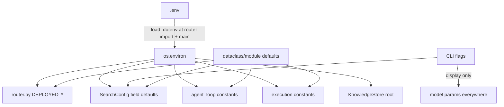

# 11 — Configuration

## Configuration hierarchy (highest precedence first)

1. **Function arguments** — e.g. `solve_ml_task(steps=24, time_limit_secs=3600)`,
   `SearchConfig(steps=25)`.
2. **Environment variables** (including those loaded from `.env` by `python-dotenv`).
3. **Code defaults** — dataclass defaults in `SearchConfig`, module constants elsewhere.

`.env` loading happens in two places: `main.main()` and — crucially — **at import of
`agent/llm/router.py`** (`router.py:39`), so every entry point (CLI, dashboard, MCP server)
honors `.env` without its own `load_dotenv()` call.

## Complete environment-variable reference (all verified in code)

| Variable | Default | Read in | Effect |
|---|---|---|---|
| `SWARN_DEPLOYED_MODEL` | `qwen3.5-9b` | `llm/router.py` (import) | Served model name for all LLM calls |
| `SWARN_DEPLOYED_BASE_URL` | Modal test URL (`…modal.run/v1`) | `llm/router.py` | OpenAI-compatible `/v1` base URL |
| `SWARN_DEPLOYED_API_KEY` | `dummy` | `llm/router.py` | Bearer key for the endpoint |
| `SWARN_SANDBOX` | *(auto-detect)* | `execution.make_backend` (per call) | Force `docker` or `subprocess` |
| `SWARN_EXEC_TIMEOUT` | `300` | `execution.py` (import) | Default per-exec timeout (s) for ReAct tools |
| `SWARN_SANDBOX_IMAGE` | `python:3.11-slim` | `execution.py` (import) | Docker image |
| `SWARN_SANDBOX_READY_IMAGE` | `swarn-sandbox:ready` | `execution.py` (import) | Pre-baked image reused instead of installing packages each boot |
| `SWARN_SANDBOX_PACKAGES` | `pandas numpy scipy scikit-learn matplotlib openpyxl` | `execution.py` (import) | Packages installed into a fresh sandbox. Set to `""` to skip; imports then fail at run time with a pointer back to this var |
| `SWARN_SANDBOX_INSTALL_TIMEOUT` | `900` | `execution.py` (import) | Seconds allowed for that install |
| `SWARN_SANDBOX_APT_PACKAGES` | `libgomp1` | `execution.py` (import) | Docker only. OS packages installed into the prepared image (pip cannot provide OpenMP, which lightgbm/xgboost need). Installed in a separate unhardened build container, never in the session container |
| `SWARN_SANDBOX_NETWORK` | `none` | `execution.py` (import) | Docker only. `none`: container is detached from the bridge after bootstrap and re-attached only while `install_package` runs pip. `bridge`: always connected |
| `SWARN_SANDBOX_USER` | `host` | `execution.py` (import) | Docker only. uid:gid generated code runs as. `host` = your uid (workspace files stay yours); `root` opts out; or an explicit `uid:gid`. pip always runs as root |
| `SWARN_SANDBOX_PIDS_LIMIT` | `512` | `execution.py` (import) | Docker only. Process cap per container (fork-bomb guard) |
| `SWARN_SANDBOX_TMPFS_SIZE` | `512m` | `execution.py` (import) | Docker only. `/tmp` is a `noexec,nosuid` tmpfs of this size |
| `SWARN_SANDBOX_MEM` | `2g` | `execution.py` (import) | Docker only. Memory limit per container (swap disabled) |
| `SWARN_SANDBOX_CPUS` | `2` | `execution.py` (import) | Docker only. CPU quota per container; fractional values allowed |
| `SWARN_MAX_ITERATIONS` | `30` | `agent_loop.py` (import) | ReAct iteration cap |
| `SWARN_CONTEXT_CHAR_BUDGET` | `400000` | `agent_loop.py` (import) | Compaction threshold (chars) |
| `SWARN_TOOL_RESULT_MAX_CHARS` | `60000` | `tools.run_tool` (per call) | Hard cap on a single tool result. Head and tail are kept, the full text is written to `workspace/.tool_output/`, and the model is told to page through it with `read_file(offset, limit)`. Compaction alone cannot stop one oversized fresh result reaching the model |
| `SWARN_BUDGET_WARN_AT` | `8` | `config.py` (import) | Iterations remaining when the loop starts warning it is running out |
| `SWARN_BUDGET_FINAL_AT` | `3` | `config.py` (import) | Iterations remaining at the final "wrap up now" notice |
| `SWARN_AUTO_APPROVE` | unset | `cli.py`, `approval_policy` (use time) | `1`/`true`/`yes` auto-approves every gated tool call. Same effect as `/yolo`; also removes the human gate in front of destructive data operations |
| `SWARN_SEARCH_WORKERS` | `1` | `SearchConfig` field default (instantiation) | Parallel search workers |
| `SWARN_CODE_MODEL` / `SWARN_FEEDBACK_MODEL` | deployed model | `SearchConfig` field defaults | Display labels; **never affect routing** |
| `SWARN_KNOWLEDGE_DIR` | `<repo>/knowledge` | `KnowledgeStore.__init__` | Playbook + runs.db location |
| `SWARN_SPECIALISTS_DIR` | unset → `~/.config/swarn/specialists`, then `<repo>/specialists` | `plugins.specialist_dirs()` (start-up, `/agents reload`) | `os.pathsep`-separated directories searched for plug-in specialists (`<name>.json`/`.yaml`, `team.json`); replaces the defaults; empty disables loading |
| `SWARN_ARTIFACTS_DIR` | `<repo>/artifacts` | `config.py` (import) | Where capabilities write annotated images and ingested documents |
| `SWARN_ENABLE_TRACING` | unset | `cli.py` | `"1"` wires `ObservabilityHooks` into the REPL's AgentLoop |
| `SWARN_CORS_ORIGINS` | `http://localhost:3000,http://127.0.0.1:3000` | `web/dashboard.py` | Comma-separated allowed origins for the dashboard API |
| `OTEL_EXPORTER_ENDPOINT` | unset | `ObservabilityHooks` | OTLP gRPC target; console exporter otherwise |

### Multi-agent runtime: memory and human-in-the-loop (all read through `config.py` at call time)

| Variable | Default | Read in | Effect |
|---|---|---|---|
| `SWARN_MEMORY_DIR` | `<repo>/knowledge/memory` | `MemoryManager.__init__` | Root of `memory.db`, `skills/`, `workflows/`, `chroma/` |
| `SWARN_MEMORY_NAMESPACE` | `default` | `MemoryManager.__init__` | Isolation key; one user's memories never enter another's context |
| `SWARN_MEMORY_BACKEND` | `auto` | `MemoryManager.__init__` | `fts` (SQLite FTS5 only), `hybrid` (vectors required), `auto` (vectors when the `rag` extra is installed) |
| `SWARN_MEMORY_CONSOLIDATE_EVERY` | `5` | `Consolidator` | New chats before the summariser consolidates episodic memory |
| `SWARN_MEMORY_TOP_K` | `5` | `ContextManagementSystem` | Semantic / episodic hits retrieved per task |
| `SWARN_MEMORY_CONTEXT_CHARS` | `6000` | `ContextManagementSystem` | Character budget of the memory section in a system prompt |
| `SWARN_MEMORY_DISABLED` | unset | `MemoryManager.__init__` | `"1"` disables all memory reads and writes |
| `SWARN_HITL_AMOUNT_THRESHOLD` | `10000` | `agent/multiagent/risk.py` | A monetary amount above this in a tool input makes the call high risk |
| `SWARN_HITL_SENSITIVE_DOMAINS` | `medical,legal` | `agent/multiagent/risk.py` | Domain vocabulary that makes a call high risk |
| `SWARN_HITL_FAILURE_THRESHOLD` | `3` | `agent/multiagent/risk.py` | Consecutive failed attempts that escalate a task to a person |

### Terminal UI

| Variable | Default | Read in | Effect |
|---|---|---|---|
| `SWARN_THEME` | `classic` | `utils/terminal_display.py` (use time) | Selects the display implementation: `classic` (green-on-black CRT) or `lain` (YAML-driven palette). Callers import the selector module, never a theme directly |
| `SWARN_NO_BOOT_ANIM` | unset | `utils/classic/*` | `1` suppresses the boot animation |

### Cleaning, profiling and reporting thresholds

These tune *judgement calls* — when a column is too empty to keep, when a number is an
outlier, when a report should flag its own data as stale. They are read at module import.

| Variable | Default | Read in | Effect |
|---|---|---|---|
| `SWARN_CLEAN_COL_NULL_DROP` | `0.5` | `data_cleaner.py` | Null fraction above which dropping a column is proposed |
| `SWARN_CLEAN_ROW_NULL_DROP` | `0.5` | `data_cleaner.py` | Same, per row |
| `SWARN_CLEAN_OUTLIER_Z` | `3.0` | `data_cleaner.py` | z-score at which a value is called an outlier |
| `SWARN_PLACEHOLDER_SHARE` | `0.75` | `data_report.py` | Token share above which report prose is judged unfilled placeholder text |
| `SWARN_THIN_ROWS_PER_LEVEL` | `20` | `data_report.py` | Rows per category level below which a breakdown is called too thin to report |
| `SWARN_SEASONALITY_MIN_DAYS` | `400` | `data_report.py` | Span needed before seasonality may be claimed |
| `SWARN_STALE_DATA_DAYS` | `365` | `data_report.py` | Age past which the report flags the data as stale |
| `SWARN_MONEY_TOKENS` / `SWARN_COST_TOKENS` | built-in lists | `data_report.py` | Comma-separated column-name hints for detecting money and cost columns |
| `SWARN_CATEGORY_SAME_DOMAIN` | `0.6` | `ml/data_pipeline.py` | Jaccard overlap at which two categorical columns are treated as the same domain |
| `SWARN_CATEGORY_LEAK_SHARE` | `0.5` | `ml/data_pipeline.py` | Share at which a category is flagged as leaking the target |
| `OPENAI_API_KEY` | — | `openai_client.py` fallback | Used only if no key passed (deployed path always passes one) |
| `NO_COLOR` | — | Rich (via `ui.py`) | Disables ANSI colors |
| AWS/GCP credential vars | — | pandas/boto3/gcsfs | Only for `load_cloud_data` |

**Read-at-import caveat:** `SWARN_MAX_ITERATIONS`, `SWARN_CONTEXT_CHAR_BUDGET`,
`SWARN_EXEC_TIMEOUT`, `SWARN_SANDBOX_IMAGE`, and the `SWARN_DEPLOYED_*` trio are captured
into module constants when their module is first imported; changing them later in-process
has no effect. `SWARN_SANDBOX` and `SWARN_KNOWLEDGE_DIR` are read at use time.

## `SearchConfig` (`agent/search/config.py`) — the one structured config object

| Group | Field | Default | Notes |
|---|---|---|---|
| Budgets | `steps` | 20 | *Additional* nodes when resuming |
| | `time_limit_secs` | None | Also shrinks per-node timeouts (`_Budget.node_timeout`, floor 30s) |
| | `exec_timeout` | 600 | Per-node sandbox timeout |
| | `token_budget` | None | in+out tokens across code+feedback clients |
| Parallelism | `parallel_workers` | env or 1 | ThreadPoolExecutor size |
| Tree policy | `num_drafts` | 4 | Independent roots |
| | `debug_prob` | 0.5 | Debug-vs-improve coin flip |
| | `max_debug_depth` | 3 | Consecutive debug chain cap |
| | `improve_topk` | 2 | Epsilon-greedy pool |
| Models | `code_model`/`feedback_model` | deployed | Display only |
| | `code_temperature` | 0.7 | |
| | `feedback_temperature` | 0.2 | |
| Environment | `runs_dir` | `<repo>/runs` | |
| | `copy_data` | True | copy vs symlink staging |
| Knowledge | `use_knowledge` | True | Inject playbook + prior art |
| | `reflect` | **False** | Post-run reflection (CLI sets `not --no-learn`; MCP server sets True) |
| | `knowledge_dir` | None → env/default | |
| Gate | `static_gate` | True | AST pre-check |
| Context | `max_term_out_chars` | 6000 | |
| | `max_memory_nodes` | 12 | |

CLI flag → config mapping is in `cli.solve` (`cli.py:126–144`). `--model/-m` sets
`code_model` (and `feedback_model` unless separately given) — display labels only.

## Hard-coded configuration worth knowing (no env override)

| Constant | Value | Location |
|---|---|---|
| `MAX_RETRIES` (LLM) | 5 | `llm/base.py` |
| Retry backoff | `min(2^attempt + rand, 30)`s | `llm/base.py` |
| `MAX_CONSECUTIVE_ERRORS` | 3 | `self_correction.py` |
| Doom window / threshold | 30 / 3 | `doom_loop.py` |
| `_KEEP_RECENT_MESSAGES`, `_TRUNC_HEAD/TAIL` | 6, 700/500 | `agent_loop.py` |
| `MAX_REVISION_CYCLES` | 3 | `orchestrator.py` |
| `MAX_OUTPUT_CHARS` (exec) | 50,000 | `execution.py` |
| Docker mem/cpu | 2g / 2 | `execution.DockerBackend` |
| Session index cap | 100 | `memory.py` |
| `PLAYBOOK_MAX_CHARS` / `LESSON_MAX_CHARS` / `MAX_SIMILAR_RUNS` | 6000 / 300 / 3 | `knowledge.py` |
| Embed model / CLIP model | `all-MiniLM-L6-v2` / `clip-ViT-B-32` | `context_engine.py` / `multimodal_rag.py` |
| Chunking | 60 lines / 10 overlap / 300KB max file | `context_engine.py` |
| `HIGH_CARDINALITY_THRESHOLD` | 20 | `feature_engineering.py` |
| `DEFAULT_TEST_SIZE` / `DEFAULT_RANDOM_STATE` | 0.2 / 42 | `model_training.py` |
| `OUTLIER_Z_THRESHOLD` | 3.0 | `data_pipeline.py` |
| MCP call/connect/disconnect timeouts | 60 / 30 / 15 s | `mcp_integration.py` |
| Dashboard port | 8420 | `cli.serve` |
| LoRA defaults | r=8, alpha=16, dropout=0.05, targets q_proj/v_proj | `finetuning.py` |

## Configuration diagram

## The "PRODUCTION ENDPOINT" contract

`router.py` carries a banner documenting the one supported way to point the system at a
production model: set the three `SWARN_DEPLOYED_*` env vars (in `.env` or exported; there are
no in-code defaults). Nothing else in the codebase needs to change — verified: every LLM
call site goes through `create_client()`.
