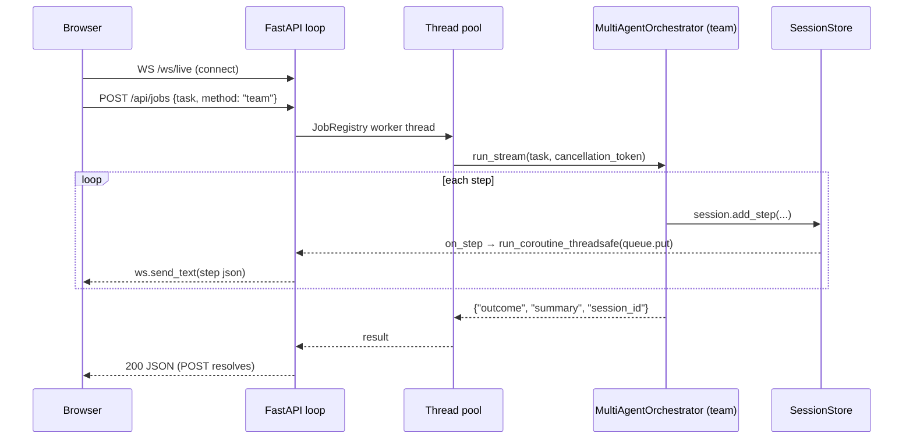

# 13 — APIs

Four public surfaces: the CLI, the dashboard HTTP/WS API, the MCP server tools, and the
programmatic Python API.

## 1. CLI (`swarn`, `agent/cli.py`)

Global options come **before** the subcommand: `--no-banner`, `-m/--model`,
`--max-iterations`, `--no-stream`, `--sandbox-tools` (run tools in a Docker sandbox instead
of the local filesystem), `-v/--version`.

Invoked with no subcommand, `swarn` opens the interactive REPL (§1.1). That is the **only**
way to give the specialist team a task: there is no one-shot `swarn "<task>"` or
`swarn team` form and no headless mode (a non-tty stdin declines every gated call). Every
other subcommand is a utility (sessions, PDF extraction, the dashboard, the MCP server).

| Command | Arguments / options | Exit code |
|---|---|---|
| `swarn sessions` | `-n/--limit` (10) | 0 |
| `swarn recall <id-prefix>` | | 0 |
| `swarn index <path>` | | 0 |
| `swarn playbook` | `--clear` | 0 |
| `swarn config` | `--path` (print the config file location and exit) | 0 |
| `swarn guardrail-benchmark` | | 0 |
| `swarn serve` | `-p/--port` (8420), `--host` (127.0.0.1) | blocks |
| `swarn mcp-serve` | | blocks (stdio) |

Also reachable without installation: `python -m agent.cli <command>`, or `python main.py`
(a shim that forwards argv unchanged).

### 1.1 REPL commands

There is **one** REPL implementation, in `agent/cli.py`. `main.py` used to carry a second,
hand-rolled one; the two drifted (commands existed in one and not the other, fixes to
either left the other stale) and it was collapsed into this shim.

| Command | Effect |
|---|---|
| *a task* | Runs the specialist team in the foreground (`_run_team_foreground`); approvals and questions on the terminal; **Ctrl+C opens the steering menu** (keep going / pause / resume / inject / switch / who / story / cancel) |
| `/help` | Command list |
| `/plan` | The team's plan view (`TeamSession.narrator.plan_view()`) |
| `/story` | Progress narrative with estimates |
| `/answer <yes\|no\|text>` | Answer a pending approval / question / escalation and continue waiting |
| `/new` | Fresh conversation: forgets the last run, clears the team's working memory |
| `/model [name]`, `/effort [level]` | Show or set |
| `/status` | Model, endpoint, last run, settings |
| `/share-traces [on\|off]` | Toggle trace sharing |
| `/yolo` | Auto-approve — every specialist runs with `approval_mode="never"` for the session |
| `/milestone [project:] <goal>`, `/phases`, `/phase [n]`, `/continue`, `/approve [text]`, `/abort-phase [skip]` | The phase loop (`agent/multiagent/phases/`, [26_Phase_Loop.md](26_Phase_Loop.md)): `_phase_loop_for` wires a `PhaseLoop` to this terminal (the team's build kwargs, `_run_team_foreground`, the approval broker for gates); `_phase_command` runs one command; `_phase_show` renders the roadmap / a phase without a model |
| `history`, `recall <id>`, `index <path>`, `report`, `guardrails` | Bare-word commands (`report` shows the last team run's result and why it ended) |
| `eval` | Subcommand re-dispatched from the prompt. Dispatched through `typer.main.get_command(app)` with `standalone_mode=False` — the *same* Click command the shell invokes, so every flag works here and the two surfaces cannot disagree. A non-zero exit or usage error is reported, not propagated: one bad command must not end the session. |

## 2. Dashboard HTTP/WS API (`agent/web/dashboard.py`)

No authentication. Binds 127.0.0.1 by default.

| Method & path | Request | Response |
|---|---|---|
| `GET /` | — | Embedded single-file HTML dashboard |
| `GET /api/sessions?limit=20` | — | `{"sessions": [index entries]}` — id, task[:80], model, outcome, duration_s, tool_calls, corrections, started_at |
| `GET /api/sessions/{id}` | id = UUID prefix (≥4 chars) | Full `trace.json` dict, or `{"error": …}` if not yet completed |
| `WS /ws/live` | client sends anything to keep-alive | JSON per step: `{session_id, task, kind, timestamp, data}` — only for runs in *this* process |
| `GET /api/runs?limit=50` | — | `{"runs":[{run_id, nodes, best_metric}]}` from `runs/*/journal.json` (corrupt journals tolerated) |
| `GET /api/runs/{run_id}` | — | `{run_id, journal: {...}, report_markdown: str}` |
| `GET /api/playbook` | — | `{"playbook": str}` |
| `GET /api/phases?project=` | optional project slug (default: the active one) | `{projects, active, project, state, roadmap, phases: [{…PhaseRecord, directory, tasks, criteria, plan_approved, verification}], context}` — the phase loop's on-disk state, read-only |

The embedded page polls `/api/sessions` (5s) and `/api/runs` (7s), auto-reconnects the
websocket (2s), and posts a team job to `/api/jobs` from a textarea.

### 2.1 Jobs and team sessions (multi-agent runtime)

`POST /api/jobs` runs a task in the background — `method: "team"` (default; accepts
`pattern` and `specialists`; cancellable) or `method: "aide"` (the tree search). The
blocking `POST /api/run` and the `react` method were removed with the single-agent loop.
The steerable form is the team-session API:

| Method & path | Effect |
|---|---|
| `POST /api/team` `{task, pattern?, specialists?, data_dir?, approval_mode?, memory?}` | start a `TeamSession`; returns its summary |
| `GET /api/team`, `GET /api/team/{id}?since=N` | list; summary + events since N |
| `POST /api/team/{id}/pause` · `/resume` · `/cancel` · `/inject` · `/switch` · `/answer` · `/agents/{name}/cancel` · `/checkpoint` | steering (see `agent/web/API.md` for bodies and status codes) |
| `GET /api/team/{id}/story` · `/attribution` · `/graph` · `/trace` · `/confidence` · `/trajectory` | the user and developer views |
| `WS /ws/live` frames with `"channel": "team"` | every runtime event of every session, narrated |

Full request/response shapes: [`agent/web/API.md`](../../agent/web/API.md).

### 2.2 Web interface API (`webui/server.py`, `swarn web`, default port 8765)

A separate FastAPI app (`webui.server:create_app`, a factory) that serves the single-page
interface from `webui/static/` and exposes the team the way the REPL does — one person,
one process, one run at a time. It has its own `SessionRegistry`; nothing here is shared
with the dashboard process.

| Route | Body / query | Notes |
|---|---|---|
| `GET /` | — | the page (`static/index.html`, `app.js`, `styles.css`) |
| `GET /api/meta` | — | settings, the specialist catalogue (each with `source` — `builtin` or the plug-in file — `core` and `roles`), `specialist_roles`, `disabled_specialists`, `plugins` (the last load report), workspace, the current run |
| `POST /api/specialists/reload` | — | re-reads the plug-in directories (`agent/multiagent/plugins.py`) and returns the load report; affects runs started from now on |
| `GET` / `PUT /api/settings` | `{model?, max_iterations?, effort?, pattern?, yolo?, memory?, verbose?}` | `model` / `effort` / `max_iterations` persist through `save_config` (the REPL's `/model`, `/effort`); `yolo` builds the next team with `approval_mode="never"`; 422 on bad values |
| `GET /api/conversations` | — | list + the current run |
| `POST /api/conversations` | — | new conversation; clears the team's working memory (`/new`) |
| `GET` / `PATCH` / `DELETE /api/conversations/{id}` | `{title}` for PATCH | 409 on DELETE while its run is going |
| `POST /api/conversations/{id}/messages` | `{text, data_dir?, pattern?, specialists?, attachments?}` | starts a run: `router.route(text, hint)` on the **bare message**, then `TeamSession.start(pattern, specialists)` on the message + the earlier turns as context + the upload note. 409 if a run is in progress, 422 for an empty text / bad `data_dir` / unknown pattern |
| `POST /api/upload` | multipart `files` | `workspace/uploads/<ms>/…`; returns `data_dir`, `relative_dir`, `files[{name,size,path}]` |
| `GET /api/runs/{id}?since=N` | — | run summary (status, outcome, routing, estimate, usage, `running_agents`, `pending` cards) + `events[N:]`, `plan`, `story` |
| `POST /api/runs/{id}/answer` | `{request_id?, approved?, answer?, note?, approve_all?}` | answers a `BrowserChannel` card (the worker thread is released); a decline with a note is also injected as a correction; `approve_all` sets the channel's auto-approve and `settings.yolo`; without `request_id`, the oldest card; `request_id: "session"` answers a **stateless** pause (`TeamSession.answer`) and restarts the watcher; 409 when nothing is pending |
| `POST /api/runs/{id}/pause` · `/resume` · `/inject {note, kind}` · `/switch {pattern}` · `/cancel {reason}` · `/agents/{name}/cancel` · `/checkpoint` | | the `TeamSession` steering surface; `resume` returns `catch_up`; `cancel` also releases parked cards with their defaults; 409 when the run is not running |
| `GET /api/runs/{id}/report` | — | result (no context), attribution, confidence + sources, story, plan, estimate, files changed during the run, the person's answers |
| `GET /api/runs/{id}/trace` · `/graph` · `/files` | | developer trace + conflicts; mermaid graph + decisions; workspace files changed since the run started |
| `GET /api/workspace/file?path=` | | a workspace file (`safe_path`; 400 on traversal) |
| `GET /api/history?n=` · `GET /api/history/{sid}` | | `SessionStore` index; `recall_as_text` |
| `GET /api/guardrails` | — | the shared `GuardrailPolicy` summary |
| `WS /ws` | — | frames `{"kind": "hello" \| "event" \| "request" \| "request.resolved" \| "run" \| "note", …}` for every run in the process; the client filters by `run_id` |

The approval / question / escalation contract is `webui/channel.py::BrowserChannel`: the
team is built with `approval_callback=channel.approve`, `human_input_callback=channel.ask`
and `HumanHandoff(callback=channel.escalate)`; each parks the worker thread on a
`PendingRequest` until the browser answers, the run is cancelled (the token is polled) or
the timeout passes — then the default applies (decline / empty / reject).

## 3. MCP server tools (`agent/integrations/mcp_server.py`)

Exposed over stdio via FastMCP as server name `swarn`:

| Tool | Signature | Behavior |
|---|---|---|
| `swarn_submit_task` | `(task, data_dir="", steps=12, mode="auto", model="")` | mode auto→`solve` iff data_dir given else `agent`. Spawns a daemon thread; returns `task_id` immediately |
| `swarn_task_status` | `(task_id)` | `running|complete|failed`, elapsed, latest message, result when done |
| `swarn_get_messages` | `(task_id)` | Header + last 100 progress messages + result |
| `swarn_list_tasks` | `()` | One line per submitted task |

Progress messages: solve mode uses the `on_step` journal callback; agent mode captures the
loop's stdout via `redirect_stdout` and keeps the last 200 lines. Solve mode sets
`reflect=True`.

## 4. Programmatic Python API

```python
# ReAct agent
from agent.core.agent_loop import AgentLoop
from agent.core.self_correction import SelfCorrectionPolicy
from agent.observability.observability import GuardrailPolicy
result = AgentLoop(correction_policy=SelfCorrectionPolicy(),
                   guardrail_policy=GuardrailPolicy()).run("task")
# → {"outcome": "complete|no_tool_use|max_corrections|max_iterations",
#    "summary": str|None, "session_id": str}

# Tree search
from agent.search import SearchConfig, run_search
res = run_search("Predict y. Metric: AUC.", data_dir="data/",
                 config=SearchConfig(steps=25, time_limit_secs=3600),
                 evaluation_note="", on_step=None, resume_run_id=None)
# → SearchResult(run_id, run_dir, journal, best: Node|None, steps_done, wall_time)
#   res.solution_path, res.report_path

# Multi-agent
from agent.core.orchestrator import Orchestrator
out = Orchestrator().run("task")
# → {"final_outcome": str, "state": BlackboardState, "report_markdown": str}

# Tool registry (for embedding/hosting)
from agent.runtime.tools import get_tool_definitions, run_tool, TOOL_REGISTRY

# LLM layer
from agent.llm import create_client
resp = create_client().call(system, messages, tools=[...], tool_choice=None)
```

### Generated deployment API (per packaged model)

`workspace/deployments/<artifact_id>/app.py` exposes:
- `GET /health` → `{"status": "ok", "artifact_id": ...}`
- `POST /predict` — Pydantic model with one `float` field per (sanitized) training feature
  column → `{"<target>": float}`; 400 with detail on inference failure.
- Auto OpenAPI docs at `/docs`.

## API sequence — dashboard live run


