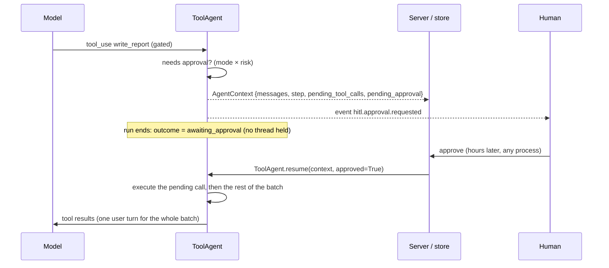
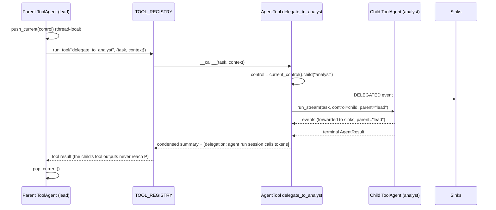
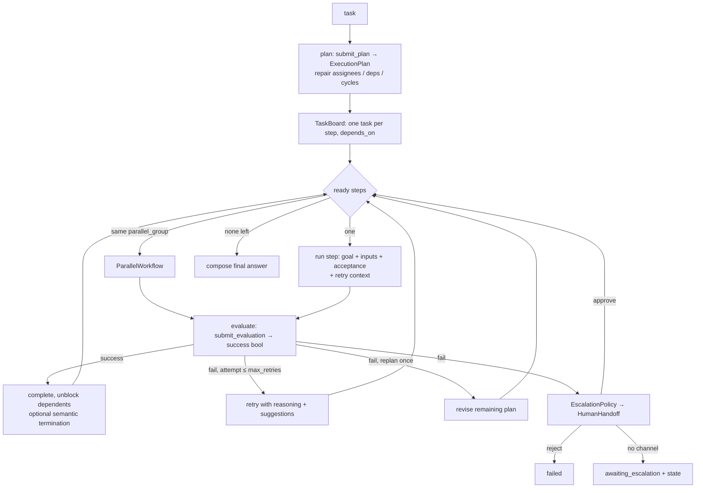

# 24 — Multi-Agent Runtime (`agent/multiagent/`)

This chapter documents the multi-agent runtime introduced by the architecture migration
tracked in [../MULTI_AGENT_PROGRESS.md](../MULTI_AGENT_PROGRESS.md). It is written to the
same standard as the rest of the LLD: every claim names the implementing file, and
anything not yet built is marked **Planned** with the stage that will build it.

Status legend: **Built** (in the repository, tested) · **Planned (Stage N)**.

---

## 1. The platform's one agent runtime

`agent/multiagent/` is the only agent engine. The earlier synchronous single-agent loop
(`agent/core/agent_loop.py`) and the fixed Planner → Coder → Reviewer → Tester pipeline
(`agent/core/orchestrator.py`, `agent/core/roles.py`) were built first, then superseded by
this runtime, and finally **removed on 2026-09-21** together with every headless way of
running an agent. What survived from them is their policy layer — the self-correction
hints, the guardrail scan, doom-loop detection, compaction, the default-deny approval policy,
the session store and the tool registry — which `ToolAgent` applies inside a streaming,
cancellable, resumable loop. The generic Planner / Coder / Reviewer / Tester roles live on as
specialist specs (`specialists.py`), and their revision loop as `build_team_pipeline()`.

The interactive REPL is the only way to give the team a task. The dashboard and the MCP
server run the team too (as background jobs and MCP tasks) but cannot approve tool calls:
a high-risk call in `auto` mode ends such a run as `awaiting_approval`, and the person
answers through the dashboard's team-session API or at the REPL.

---

## 2. Module map (Built — Stage 1)

| Module | Class / function | Responsibility |
|---|---|---|
| `cancellation.py` | `CancellationToken`, `CancelledError`, `PauseGate` | Thread-safe, hierarchical stop signal; a gate a worker waits at while paused |
| `control.py` | `RunControl` | What a UI holds: cancel / pause / resume / inject; `checkpoint()` for agents |
| `events.py` | `AgentEvent`, `EventType`, `narrate()` | The typed stream; plain-language narration for end users |
| `context.py` | `AgentContext`, `messages_to_dicts()` | Serialisable run state for stateless human-in-the-loop |
| `middleware.py` | `Middleware`, `MiddlewareChain`, `LoggingMiddleware`, `PIIRedactionMiddleware`, `RateLimitMiddleware`, `AuditMiddleware`, `CallContext`, `MiddlewareBlock` | Control and observability around every model and tool call |
| `risk.py` | `risk_of_tool()`, `rule_triggers()`, `amounts_in()`, `HIGH_RISK_TOOLS` | Low/high tiers and the spec's rule-based delegation triggers |
| `base.py` | `BaseAgent`, `AgentResult`, `register_agent_type()`, `AGENT_TYPES` | The run / run_stream / arun / arun_stream contract; config round-trip |
| `agent.py` | `ToolAgent`, `validate_human_answer()` | The streaming ReAct loop over `TOOL_REGISTRY` (the `request_human_input` tool itself is registered in `agent/runtime/tools.py`) |
| `specialists.py` (Stage 3) | `AgentSpec`, `SPECIALISTS`, `build_agent()`, `find_specialists()`, `spec_from_json()` | The catalogue of specialist agents as data |
| `agent_tool.py` (Stage 3) | `AgentTool`, `register_agent_tool()`, `register_specialist_tool()`, `add_event_sink()` | Agents as tools with context isolation and control inheritance |

Import layering is strictly top-down in that order; `agent.py` is the only module that
imports from `agent.core`, `agent.runtime`, `agent.memory` and `agent.llm`.

---

## 3. Cancellation and pausing (`cancellation.py`, `control.py`)

```mermaid
flowchart LR
    UI[CLI / dashboard / API] -->|cancel / pause / inject| RC[RunControl "team"]
    RC --> T[CancellationToken team]
    RC --> G[PauseGate]
    RC --> IB[(inbox of notes)]
    RC -->|child| RC1[RunControl "analyst"]
    RC -->|child| RC2[RunControl "coder"]
    T -->|cancel propagates| T1[token analyst]
    T -->|cancel propagates| T2[token coder]
    RC1 -->|checkpoint()| A1[ToolAgent analyst]
    RC2 -->|checkpoint()| A2[ToolAgent coder]
```

- `CancellationToken.check(where)` raises `CancelledError`, which subclasses
  `asyncio.CancelledError` (a `BaseException`). Tool bodies and policies use
  `except Exception`, so the signal cannot be swallowed on its way to the loop that owns the
  run (D3). Verified by `test_check_raises_a_cancelled_error_that_except_exception_does_not_swallow`.
- Cancelling a parent cancels every child; cancelling a child leaves the parent running
  (granular agent control). A child created after the cancel inherits it.
- `as_event()` / `from_event()` bridge to the `threading.Event` that `AgentLoop.run(stop_event=…)`
  and `web/jobs.py` already use, so the two mechanisms share one signal.
- `PauseGate.wait_if_paused()` blocks the worker until `resume()`; a cancel while paused
  releases the gate and raises, so a paused run is still stoppable.
- `RunControl.checkpoint(where)` is the single call an agent makes at each safe stop point:
  raise if cancelled → block while paused (accumulating `total_paused_secs`) → return the
  injected notes. Notes on a parent control are delivered to whichever member checkpoints
  next; notes on a child only to that agent.

Checkpoints in `ToolAgent`: **before every model call** and **before every tool execution**
(`agent.py`, `_checkpoint`). Orchestrators add one between steps (Stage 4).

---

## 4. The event stream (`events.py`)

Every agent is a generator of `AgentEvent(type, agent, run_id, step, parent, ts, data)`.
`to_dict()` is JSON-safe (LLM blocks are converted with `block_to_dict`, unknown objects fall
back to `str`). `EventType` groups:

| Group | Types |
|---|---|
| lifecycle | `agent.started`, `agent.completed`, `agent.failed`, `agent.cancelled`, `agent.awaiting`, `agent.paused`, `agent.resumed` |
| loop | `step.started`, `model.call.started/finished`, `agent.text`, `tool.call`, `tool.result`, `tool.blocked`, `policy.correction`, `policy.guardrail`, `policy.doom_loop`, `policy.budget`, `context.compacted`, `control.note` |
| humans | `hitl.approval.requested/resolved`, `hitl.input.requested/received`, `hitl.escalated` |
| orchestration (Stage 4+) | `orchestration.plan`, `orchestration.step.started/evaluated/retry`, `orchestration.handoff`, `orchestration.delegated`, `orchestration.pattern_switched`, `orchestration.conflict`, `orchestration.termination`, `task.updated` |
| observability | `memory`, `progress`, `usage` |

The terminal event (`event.is_terminal`) always carries the `AgentResult` in
`data["result"]`; `BaseAgent.collect()` relies on that. `narrate(event)` renders any event
as one plain-language sentence — the "simple progress narrative" surface for end users.

---

## 5. Stateless human-in-the-loop (`context.py`, `agent.py`)



What `AgentContext` carries and why: `messages` (LLM blocks as dicts), `step` (the
iteration budget continues), `pending_tool_calls` and `completed_tool_results` (the batch
resumes exactly where it stopped), `pending_approval` / `pending_human_input`, `facts`
(digests kept by compaction), `usage`, `consecutive_errors` and `corrections` (the
correction policy's budget survives the exit), `session_id` (the same trace on disk is
reopened — `ToolAgent._open_session` rebuilds a `Session` from `trace.json`).

Approval decision matrix (`ToolAgent._needs_approval`, `risk.py`):

| `approval_mode` | read-only tool | gated, low risk | gated, high risk |
|---|---|---|---|
| `never` | run | run | run |
| `auto` (default) | run | run | **approval** |
| `always_require` | run | **approval** | **approval** |

"Approval" goes through, in order: a synchronous `approval_callback` (the REPL), an
`approval_broker` (`agent/core/hitl.py`, parks the thread — dashboard jobs), or the
**stateless exit** above. A refusal is fed back to the model as
`Error: the user declined to approve …` so it can take another route.

High risk = tool in `HIGH_RISK_TOOLS` (shell, package install, SQL/cloud loads, MCP,
delete, fine-tune, LLM eval spend, tree search, packaging) **or** any `mcp_*` tool **or** a
rule trigger read from the tool input: an amount above `SWARN_HITL_AMOUNT_THRESHOLD`
(10,000 by default, INR per the spec) or vocabulary from `SWARN_HITL_SENSITIVE_DOMAINS`
(`medical,legal`). `rule_triggers(text, consecutive_failures)` also implements the "three
consecutive failed attempts" trigger used by the delegation policy (Stage 4/5).

Human input: `ask_human` and `request_human_input` are intercepted before dispatch
(`HITL_INPUT_TOOLS`). The answer is validated (`validate_human_answer`: fixed options,
1-based index, number). An unusable answer is re-asked, twice at most; the third failure
ends the run with outcome `failed` and the error *"failed to continue due to incorrect
inputs"* (`MAX_HUMAN_INPUT_ATTEMPTS = 3`). The same rule applies through a live
`human_input_callback`, the broker, or stateless exits.

---

## 6. Middleware (`middleware.py`)

Onion order: `before_*` in list order, `after_*` in reverse. `MiddlewareBlock` from
`before_model` ends the run with outcome `blocked`; from `before_tool` it becomes the tool
result `Error: blocked by <name>: <reason>`.

| Middleware | What it does | Notes |
|---|---|---|
| `LoggingMiddleware` | records every model call (duration, tokens, stop reason, text preview, tool uses) and every tool call (duration, previews, error flag) in a bounded deque and optionally a JSONL file | |
| `PIIRedactionMiddleware` | scans model text output (and tool results when `scan_tool_results=True`) for email, Indian mobile numbers, international numbers, Aadhaar, PAN, Luhn-valid card numbers, IPv4, US SSN; `mode="redact"` replaces with `[REDACTED:<kind>]`, `mode="block"` raises | plain numbers (row counts, percentages) are not matched — verified in tests |
| `RateLimitMiddleware` | sliding-window calls/minute per rate key (user → session → run), max calls per run, max tokens per run, max cost (via the prices in `agent/llm/base.py`; ignored when no price is configured) | injectable clock for tests |
| `AuditMiddleware` | append-only JSONL, each record hash-chained to the previous (`prev_hash`, `hash`); `verify_chain(path)` detects any edit; exports a span per record when given `ObservabilityHooks` | default location `runs/audit/<run_id>.jsonl` |

All four implement `to_config()` / `from_config()`; `MIDDLEWARE_TYPES` maps names to classes
and `register_middleware()` adds custom ones so a saved team configuration can be restored.

---

## 7. `ToolAgent` — the loop (`agent.py`)

Per iteration (mirrors `AgentLoop`, with the additions in bold):

1. **checkpoint** (cancel / pause / notes) → `step.started`
2. **compaction with fact retention**: once `_message_chars` exceeds the agent's
   `context_char_budget`, old `tool_result` blocks (all but the last 6 messages) are
   truncated head+tail; before each truncation up to three number-bearing lines are saved
   into `context.facts` and shown to the model afterwards under
   *"Facts retained from compacted context"* in the system prompt
3. **memory augmentation**: if a memory manager is attached, `build_context(task, agent=…)`
   is appended to the system prompt (Stage 2)
4. **middleware.before_model** → LLM call (OTel span if hooks given) → **middleware.after_model**;
   usage accumulated into the context
5. `agent.text` events for text blocks; assistant message appended as dicts
6. no tool calls → `complete` (text accepted when `allow_text_completion`) or `no_tool_use`
7. for each tool call, one at a time: **checkpoint** → `tool.call` → human-input
   interception → **approval gate** → **middleware.before_tool** → `run_tool` →
   **middleware.after_tool** → `result_filter` and per-agent `tool_result_max_chars` →
   self-correction (`policy.correction`) → guardrail (`policy.guardrail`) → doom loop
   (`policy.doom_loop`) → session `TOOL_RESULT` (raw) → `tool.result` event
8. `finish_task` → one-shot summary review (`_review_summary`, reused) → `complete`
9. budget notices (`policy.budget`), abort on the correction budget (`max_corrections`),
   iteration cap (`max_iterations`)

Outcomes: `complete`, `awaiting_approval`, `awaiting_input`, `cancelled`, `blocked`,
`max_iterations`, `max_corrections`, `no_tool_use`, `failed`, `error`. Every path ends with a
`usage` event and one terminal event; the session is closed, or checkpointed when the
context is resumable.

Construction knobs worth knowing: `llm=` (inject a client — tests use
`tests/fakes_multiagent.ScriptedLLM`), `record_session=False` for throwaway sub-runs,
`approval_mode`, `approval_callback` / `approval_broker` / `human_input_callback`,
`risk_of=` (override the tier function), `middleware=`, `memory=`, `result_filter=`,
`tool_result_max_chars=`, `context_char_budget=`, `temperature=`.

`to_config()` serialises everything except the injected client and callbacks;
`ToolAgent.from_config(cfg, llm=…)` restores it, including the middleware chain and (Stage 2)
the memory configuration. `BaseAgent.from_config` dispatches on `"type"` through
`AGENT_TYPES`.

---

## 8. Async surface (`base.py`)

`arun()` runs `run()` in a worker thread (`asyncio.to_thread`). `arun_stream()` runs
`run_stream()` in a daemon thread and hands each event across a `queue.Queue`; the consumer's
event loop is never blocked by a model or tool call, and an exception in the worker is
re-raised in the consumer (D2). Verified by `test_async_surface_streams_and_collects`.

---

## 9. Tests

`tests/test_multiagent_runtime.py` (33 tests) covers every property in this chapter without
a model endpoint: scratch tools are injected into `TOOL_REGISTRY`, the LLM is scripted, and
the session store is redirected to a temporary directory for the continuity test.

---

## 10. Specialists and agents-as-tools (Built — Stage 3)

### 10.1 Tool categories (`agent/runtime/tool_categories.py`)

See [09_Tool_Execution.md](09_Tool_Execution.md#tool-categories-and-agents-as-tools-multi-agent-runtime).
The split is a partition of `CATEGORIES`; `tools_in()` resolves category names to registered
tools; `describe_tools(names)` renders the per-specialist catalogue that goes into a prompt
(grouped by category, descriptions read live from the registry so they never drift).

### 10.2 The catalogue (`agent/multiagent/specialists.py`)

`AgentSpec` = name, title, group, description, **mission**, `tool_categories` +
`extra_tools` − `excluded_tools`, `capabilities` (keywords the router and the plan-based
orchestrator match), `approval_mode`, `max_iterations`, `allow_text_completion`, `memory`,
`middleware` configs, `model`, `temperature`, `source` (`"builtin"` or the plug-in file).
`to_dict()/from_dict()` and `spec_from_json()` (validated: a misspelt field, an unknown tool
category or a bad name is an error) make the catalogue editable as data; `register_spec()`
adds one at runtime, `unregister_spec()` / `disable_spec()` / `enable_spec()` remove and
restore, `reset_catalogue()` puts the shipped catalogue (`BUILTINS`) back.

**Roles and core specialists (Stage 13).** The runtime never names a specialist: the
pipeline, the phase loop and the router's fallbacks call `role("implementer")`,
`role("reviewer")`, `role("analyst")`… and `ROLES` (defaults in `DEFAULT_ROLES`: `planner`,
`implementer`, `reviewer`, `tester`, `analyst`, `investigator`, `data_scientist`,
`ml_builder`, `debugger`) says which specialist fills each. `set_roles()` rebinds (every
target must exist). A specialist a role is bound to is **core** (`is_core()`, `roles_of()`):
`unregister_spec` / `disable_spec` refuse it, naming the role, so nothing the runtime relies
on can be removed by accident — rebind the role and it becomes an ordinary entry. A role name
is also an alias in `get_spec()`, so a plan assignee or `/team` name of `reviewer` resolves
to whoever fills that role.

**Plug-ins (`agent/multiagent/plugins.py`).** `load_plugins()` rebuilds the catalogue from
the built-ins plus every `<name>.json` / `.yaml` in the plug-in directories
(`~/.config/swarn/specialists/`, `<repo>/specialists/`; `SWARN_SPECIALISTS_DIR` overrides)
and applies each directory's `team.json` manifest (`disabled`, `roles`). A bad file is an
entry in the `LoadReport`, never an exception; `ensure_loaded()` runs it once per process
(REPL start-up, web `Runtime`, dashboard jobs, MCP server) and `force=True` is the reload
behind `/agents reload` and `POST /api/specialists/reload`. `write_template()` is `/agents
new`. See `docs/LLD/20_Extension_Guide.md` for the file format.

| Group | Specialists |
|---|---|
| analysis | `descriptive_analytics` (what happened), `diagnostic_analytics` (why), `predictive_analytics` (what will), `prescriptive_analytics` (what to do), `operations_analyst`, `business_systems_analyst`, `data_science_analyst`, `bi_analyst`, `bi_engineer`, `bi_developer` |
| ml | `classical_ml_builder` (rigour contract: metric → split → leakage → features → train → tune → diagnostics → report), `deep_learning_builder` (MLP candidate, custom PyTorch in the sandbox, LoRA/QLoRA fine-tuning) |
| evaluation | `llm_evaluator` — `design_llm_eval` → approval → `evaluate_llm`; comparisons, judge suites, prompt A/B |
| debugging | `debug_optimizer` — reproduce → fix → prove; leakage hunting; measure-first inference speed-ups |
| generic | `planner`, `coder`, `reviewer`, `tester` — the Phase 11 roles re-expressed as specs (missions taken from `agent/core/roles.py`) so the legacy pipeline runs on the new runtime |

Every prompt = the shared core of `agent/messaging/prompts.py` (via `roles._SHARED_CORE`) +
`━━━ Your role ━━━` mission + `━━━ Team protocol ━━━` (stand-alone summaries; confidence and
data sources per claim; ask a person once, with options, for money/medical/legal or
answer-changing ambiguity; stay in mission; never fabricate a number) + `━━━ Your tools ━━━`.

`build_agent(name, llm=, memory=, middleware=, approval_mode=, …)` returns a `ToolAgent`;
`memory=None` attaches the process-wide `MemoryManager` when the spec wants memory and
`SWARN_MEMORY_DISABLED` is not set. `find_specialists(text)` scores specs by capability
keywords (the deterministic first pass of the Stage 4 router); `catalogue_text()` is what
the plan-based orchestrator's planner sees when it assigns steps.

### 10.3 Agents as tools (`agent/multiagent/agent_tool.py`)



Verified in `tests/test_specialists.py`: isolation (a child's `read ok` never appears in the
parent's messages), event forwarding with the parent's name, `usage` accounting, cancelling
the parent control while the child is mid-run ends the child with `cancelled` and the parent
with `cancelled` at its next checkpoint, and a nested `awaiting_approval` comes back as a
summary within milliseconds with the child's context kept in `AgentTool.pending`.

---

## 11. Orchestration (Built — Stage 4)

### 11.1 Modules

| Module | Classes | Responsibility |
|---|---|---|
| `structured.py` | `call_structured()`, `schema_for()`, `extract_json_object()` | Forced tool call → Pydantic model; JSON-in-text fallback; one validation retry; `None` on failure (D7) |
| `task_board.py` | `Task`, `TaskBoard` | The task-management pattern shared by every orchestration type: statuses, enforced transitions, dependencies, blocking, retries, progress, narrative, JSON |
| `termination.py` | `SemanticTermination`, `ExternalSignalTermination`, `KeywordTermination`, `MaxRounds/MaxTime/TokenBudgetTermination`, `CompositeTermination`, `default_termination()` | When an autonomous coordination is done |
| `delegation.py` | `RuleBasedDelegation`, `LLMBasedDelegation`, `EscalationPolicy`, `HumanHandoff`, `HumanRequest` | When and how a decision goes to a person |
| `patterns.py` | `CoordinationState`, `Pattern`, `Step`, `SequentialWorkflow`, `ParallelWorkflow`, `ConditionalWorkflow`, `ConversationOrchestrator`, `HierarchicalAgent`, `pattern_from_config()`, `verdict_keywords()` | The pattern library |
| `planner.py` | `ExecutionPlan`, `PlanStep`, `StepEvaluation`, `PlanBasedOrchestrator` | Plan → execute → evaluate → retry → replan → escalate |
| `router.py` | `TaskRouter`, `RoutingDecision` | Pattern-to-task alignment, rules first then the model |
| `orchestrator.py` | `MultiAgentOrchestrator`, `build_team_pipeline()` | The facade: route, run, switch patterns, resume; the legacy pipeline on the new runtime |

### 11.2 Pattern-to-task alignment (`router.py`)

| Signal in the task | Pattern | Built as |
|---|---|---|
| exploratory wording ("explore", "investigate", "brainstorm", "figure out", "discuss") | `conversation` | `ConversationOrchestrator` with the matched specialists, model speaker selection when a model is configured |
| "independently", "separately", "in parallel", "compare … both/two", "for each dataset" | `parallel` | `ParallelWorkflow`, `require="any"`; with one matched specialist the two general analysis lenses are added |
| no specialist keyword matched | `conversation` | descriptive + diagnostic analytics |
| one specialist clearly dominates, no ordering words | `single` | that specialist's `ToolAgent` |
| ordering words ("then", "after that", sentence-initial "first/next", numbered lines) and ≥ 2 specialists | `sequential` | `SequentialWorkflow`, `final="all"` |
| ≥ 3 specialities, or a long multi-part task | `plan` | `PlanBasedOrchestrator` |
| 2 specialities, no order | `plan` (with a model) / `sequential` (without) | |

Rule confidence below `min_confidence` (0.6) consults the model through `choose_pattern`.
`route(task, hint=…)` honours an explicit pattern; every decision records `source`
(`rule` / `llm` / `hint` / `resume` / `switch`) and a reason, surfaced as the first
`progress` event of a team run.

### 11.3 The shared machinery (`Pattern`, `CoordinationState`)

Every pattern is a `BaseAgent` (so patterns nest — hierarchical composition — and can be
`delegate_to_*` tools). They share:

- **one `TaskBoard` per run**: each step / branch / round is a task; the board enforces
  `pending → in_progress → completed | failed | awaiting_human | cancelled`, blocks dependents
  of a failed task, counts attempts, and emits `task.updated` events;
- **`CoordinationState`** (JSON): results and summaries per step in completion order, the
  transcript, the board, injected notes, retained facts, conflicts, the pending child
  (`step`, `agent`, `kind`, serialised `AgentContext`, question), the switch history, usage.
  It is returned in `AgentResult.state`; `work_so_far()` is what later steps and a switched
  pattern receive;
- **`_stream_child()`**: runs any agent as `control.child(agent.name)` with `parent=<pattern>`,
  forwards its events, records the result and the board transition, and returns the result;
- **resume**: a pattern given a state skips completed steps and resumes the pending child
  with `decision=` / `answer=`; verified on fresh instances for sequential, parallel,
  conditional, conversation and plan-based runs;
- **pattern switch**: `state.switch_to` set by the facade ends the pattern at its next step
  boundary with outcome `pattern_switch` (a `PATTERN_SWITCHED` event carrying the state);
- **checkpoints**: `_deliver_notes()` at every boundary — cancel, pause (PAUSED / RESUMED with a
  catch-up line), injected notes appended to the next child's task.

### 11.4 The patterns

| Pattern | Key behaviour |
|---|---|
| `SequentialWorkflow(steps, final)` | templates `{task} {previous} {previous_all} {results[name]} {notes}`; `on_fail` = stop / continue / retry (retry folds the failure into the task); `condition(state)` skips a step; **gates**: `verdict(result)` false → back to `retry_from` with the reviewer's feedback, up to `max_revisions` (the Phase 11 revision loop); `HANDOFF` events between steps |
| `ParallelWorkflow(branches, require, aggregate, task_templates, max_workers)` | one thread per branch, each with its own child control; events funnelled live through a queue; `require` all / any / majority; default aggregate `## branch` sections; a branch that exits for a person makes the whole workflow `awaiting_*` with that branch pending |
| `ConditionalWorkflow(branches, router, default, llm, descriptions)` | choice order: router function → model (`choose_branch`) → capability keywords of branches that are specialist specs → default; the choice is a `HANDOFF` event with source and confidence |
| `ConversationOrchestrator(participants, speaker_selection, llm, termination, max_rounds, moderator, detect_conflicts, compose_final)` | shared transcript; speaker selection round-robin / `auto` (`select_speaker`) / function; termination default = external + semantic (with a model) + keyword `TASK_COMPLETE` + max rounds; **conflicts**: explicit disagreement or the same numeric claim with a different value → `CONFLICT` event, resolution by the moderator agent, else the model (`resolve_conflict`), else "latest statement stands", all logged in `state.conflicts`; injected notes enter the transcript as user turns; final answer composed by the model when available |
| `HierarchicalAgent(inner, name, description, capabilities)` | a composite with its own identity; result `children` nest |

### 11.5 Plan-based orchestration (`planner.py`)



Without a model: a heuristic plan from capability keywords (one or two steps) and
"completed with a summary" as the evaluation. Everything a resume needs (plan, attempts,
consecutive failures, replanned flag) lives in `state.extra`.

### 11.6 The facade (`orchestrator.py`)

`MultiAgentOrchestrator(llm, router, agent_factory, build_kwargs, delegation, handoff, memory,
max_rounds, default_pattern)`; `run_stream(task, control, pattern, specialists, context,
decision, answer)`. `switch_pattern(name)` is honoured at the running pattern's next step
boundary: the completed summaries are appended to the task as "Work completed so far", the
new pattern is built, and a `PATTERN_SWITCHED` event records the transition (at most three
switches per run). `resume(state, approved= | answer=)` re-enters the stored pattern. The
result's `artifacts` carry the pattern, the specialists, the duration and the switch count;
`children[0]` is the pattern's result, whose `children` are the steps.

`build_team_pipeline()` is the Phase 11 pipeline expressed as a `SequentialWorkflow` with
`verdict_keywords()` gates on the reviewer and tester steps sending work back to the coder.
`agent/core/orchestrator.py` remains for callers that use it directly.

### 11.7 Tests

`tests/test_orchestration.py` (19 tests) drives every pattern with scripted agents
(`tests/fakes_multiagent.FakeAgent`) and scripted models: concurrency is asserted by timing
and thread names, cancellation by a mid-run stop, resumability by serialising the state to
JSON and continuing on new instances, pattern switching by requesting it from inside the
event loop, and the plan-based path through retry → replan → escalation → resume.

---

## 12. Interruptibility — `TeamSession` (Built — Stage 5, `controller.py`)

The generators above only move when something pulls the next event. `TeamSession` gives a UI
the opposite shape: a run that proceeds on a background thread while the UI reads its events
and presses buttons. It wraps **any** `BaseAgent` — a specialist, a pattern, the facade.

| Call | Effect |
|---|---|
| `start(**run_kwargs)` | run `agent.run_stream(task, control=…)` on a daemon thread; events are buffered (`events(since=)`, `n_events`), pushed to `on_event`, recorded by a `TrajectoryRecorder` and a `ProgressNarrator` |
| `pause()` / `resume()` | close / open the session's `PauseGate`; the session emits its own `agent.paused` / `agent.resumed` markers the moment the button is pressed, and the agents emit theirs when the pause takes effect at their next checkpoint; `resume()` returns the **smart-resume catch-up** (`catch_up()`: events since you last looked, steps finished, current step, notes delivered, plan progress, what is waiting for you) |
| `inject(note, kind)` | gentle interruption: copied to the agent working now, consumed by the coordinator at its next boundary and recorded for later steps (see `control.py`) |
| `cancel(reason)` | graceful cancel through the token; completed work stays in the result's state |
| `switch_pattern(name)` | forwarded to `MultiAgentOrchestrator.switch_pattern` (an error for agents that cannot switch) |
| `agent_control(name)` / `control_of(name)` / `running_agents()` | granular per-agent control: `control_of("coder").cancel()` stops one nested agent while the coordination flow continues |
| `answer(approved= \| answer=, note=)` | continue a run that exited for a person: re-enters with the stored `CoordinationState` (patterns) or `AgentContext` (a single agent) on a fresh control |
| `restart()` | run the task again from the top |
| `checkpoint(path)` / `TeamSession.load(path, agent= \| agent_factory=)` | **save progress**: id, task, status, `agent.to_config()`, run kwargs, the result (with its state), the live coordination state of a running orchestrator, history, the last 2,000 events; reload elsewhere and `answer()` or `restart()` (`auto_checkpoint=True` saves whenever a run ends, including an `awaiting_*` exit) |
| `pending_request()`, `summary()`, `story()`, `attribution()`, `wait(timeout)` | what a UI shows |

`SessionRegistry` (`get_session_registry()`) keeps live sessions by id and fans every event
out to registered listeners — the dashboard's websocket bridge in Stage 7.

---

## 13. Observability and provenance (Built — Stage 6, `provenance.py`)

Everything here derives from `AgentEvent`s only.

| Audience | Class | Gives |
|---|---|---|
| everyone | `TrajectoryRecorder` | the trajectory of a run: `messages` (reasoning text, notes, progress), `actions` (tool calls/results/blocks, delegations, handoffs, approvals), `outcomes` (terminal events, evaluations, retries, escalations, terminations, switches, conflicts), `metadata` (duration, events, agents, tokens/calls/tool calls/errors/model time **per agent**, totals), `final`; `save()` to `runs/trajectories/<run_id>.json`, `load()`, and `to_eval_sample()` — the `trajectory` column shape `swarn/capabilities/llm_eval/metrics/trajectory.py` scores (evaluation-driven development) |
| end users | `ProgressNarrator` | real-time activity: narrated lines (`narrate()`), the plan view with ✓ / ▶ marks, the current step, `estimate()` (elapsed, steps done/total, estimated remaining time at the pace so far, usage, cost when prices are configured), `story()` |
| end users | `OutcomeAttribution.explain(events)` | when things go wrong: the **deepest** failing agent, the step, the last failing tool, the correction attempts, the reason — in one sentence, plus a causal chain; distinguishes cancelled / awaiting / blocked / failed |
| end users | `ConfidenceIndicator.indicators(events, memory_sources)` | the confidence each specialist stated in its summary (the team protocol asks for it) and the data sources it touched (loads, reads, document questions, memory recalls) plus the memory records the context manager used |
| developers | `CoordinationGraph` | `edges()` (runs / handoff / delegated / switch), `decisions()` (routing, branch choices, evaluations, approvals, escalations, terminations with source and confidence), `mermaid()` |
| developers | `ConflictLog` | every `orchestration.conflict` with its resolution and source |
| developers | `developer_trace(events)` | the conversation-aware log: relative time, `parent›agent`, step, tokens and model time, tool calls with previews, shared-state changes (`task.updated`), handoffs, outcomes |

The audit trail (`AuditMiddleware`, §6) remains the compliance-grade record; the trajectory
is the analysis-grade one.

---

## 14. Integration (Built — Stage 7)

| Surface | File | What it does |
|---|---|---|
| Terminal rendering | `agent/multiagent/render.py` — `TerminalRenderer(verbose)` | maps events onto `agent/utils/ui.py`: reasoning panels, dim tool lines, warnings for corrections / guardrails / blocked calls / escalations, rules for plans and steps, handoffs, pause/resume, a green/red outcome panel; `verbose=True` adds model timings, task-board changes and usage. `render_summary`, `render_attribution`, `format_result_json`. |
| REPL (the only way to run a task) | `agent/cli.py` — a task at the prompt → `_build_team_session` + `_run_team_foreground`; Ctrl+C → `_steer_menu` / `_steer`; `/story`, `/plan`, `/answer`, `report` | the team runs in the **foreground**: `approval_mode="always_require"` with the terminal `_Approver` (every side-effecting call is shown and approved; `/yolo` → `"never"`), `_terminal_question` for questions and escalations, `_print_grounded_tool_result` for document evidence, one shared `GuardrailPolicy`. A `_PromptGuard` flag marks when a worker owns the terminal so Ctrl+C never opens a second prompt on top of an approval. A non-tty stdin **declines** gated calls — there is no headless mode and no one-shot `swarn team` command |
| Job registry | `agent/web/jobs.py` — `method: "team"` | runs on the new runtime; the job's stop event is the run's cancellation token (`CancellationToken.from_event`), so cancel reaches nested agents; narrated `team` events; `pattern` / `specialists` accepted; `team_agent_factory` / `team_llm` hooks for tests |
| Web interface (`swarn web`, 2026-09-22) | `webui/server.py` (`Runtime`, `create_app`), `webui/channel.py` (`BrowserChannel`), `webui/conversations.py`, `webui/static/` | the browser equivalent of the REPL row above: the same `MultiAgentOrchestrator` with `approval_mode="always_require"` and the three prompts answered by cards — `BrowserChannel.approve / ask / escalate` park the worker thread until `POST /api/runs/{id}/answer`, a cancel (token polled) or the timeout (default declines). One run at a time; the router sees the bare message while the specialists get the earlier turns as context; events, cards and status stream on `WS /ws`; transcripts in `runs/webui/conversations.json`; a stateless `awaiting_*` exit is answered through `TeamSession.answer` like the REPL's `/answer`. Tests: `tests/test_webui.py` |
| Dashboard | `agent/web/dashboard.py` — `/api/team/*` | `SessionRegistry`-backed sessions: start, list, detail with `since=`, pause, resume (with catch-up), inject, switch, cancel, per-agent cancel, answer, checkpoint, story, attribution, graph, trace, confidence, trajectory; websocket channel `"team"` with narrated events; `TEAM_SETTINGS` for the model / agent factory |

Cancellation robustness added here: `ToolAgent._call_model` runs the model call on a worker
thread and waits on the token, so a cancel is honoured *during* a model call or its retry
loop (the orphaned call's result is discarded); `CancellationToken.is_cancelled()` walks the
ancestor chain so a root token wrapped around a raw `threading.Event` (the job registry's
stop event) is seen by every child; every consumer of a child stream (facade, patterns,
`HierarchicalAgent`, `TeamSession`, `JobRegistry`) converts a raised `CancelledError` into a
cancelled outcome.

Tests: `tests/test_team_integration.py` (5 tests) — renderer coverage of every event type in
both views, a cancellable team job, the full `/api/team` flow through FastAPI's test client
(pause → inject → resume → complete, answer an awaiting run, cancel one agent by name,
websocket bridge), the foreground REPL run with every steering action, `/plan` and `report`,
and the guarantee that the approval prompt declines without a terminal, that no `team` or
`run` subcommand exists and that the deleted single-agent modules no longer import.
