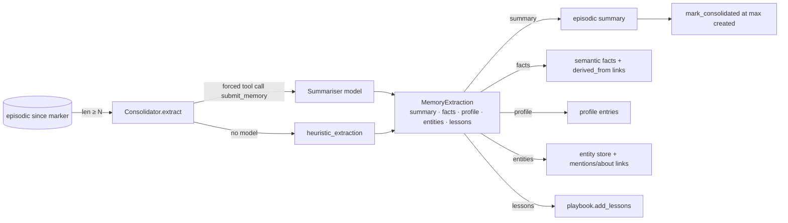

# 25 — Memory System (`agent/memory/`)

The memory system implements the two memory diagrams of the multi-agent architecture
(tracker: [../MULTI_AGENT_PROGRESS.md](../MULTI_AGENT_PROGRESS.md) §2.4). Every claim below
names the implementing file. Status: **Built** (Stage 2), tested by
`tests/test_memory_system.py` (11 tests, no optional dependency needed).

---

## 1. The taxonomy, mapped to code

```
Memory
├── Short term
│   ├── Working memory   working.py   WorkingMemory   — the context RAM: pinned task/plan,
│   │                                                    recent items, HeadTail compaction that
│   │                                                    keeps a digest (facts) of what it drops
│   └── Cache            working.py   MemoryCache     — LRU + TTL, keyed by content hash
└── Long term            (one HybridMemoryStore, one namespace)
    ├── Episodic         long_term.py EpisodicMemory  — conversational turns, summaries, observations
    ├── Semantic         long_term.py SemanticMemory  — facts, knowledge base, user profile,
    │                                                    entity store, persona store
    ├── Associative      long_term.py AssociativeMemory — edges: episode→entity (mentions),
    │                                                    summary/fact→entity (about), fact→episode
    │                                                    (derived_from), persona→skill/workflow (uses)
    └── Procedural       long_term.py ProceduralMemory — Skills.md files (+ the playbook), the
                                                         toolbox store, the workflow store

Retrieval  context_manager.py  ContextManagementSystem: Retrieve → Rank → Resolve → Assemble
Consolidation  consolidation.py  Consolidator: after N new chats, summariser → durable facts
Facade  manager.py  MemoryManager (+ agent tools remember / recall_memory / forget_memory /
                    list_skills / memory_status)
```

The pre-existing stores are not replaced: `memory.py` (session traces) stays the raw
record of every run; `knowledge.py` (playbook + FTS5 run archive) is exposed as the
`playbook` skill and receives the consolidator's lessons, so the tree search and the team
learn from the same place; `context_engine.py` (repo-RAG over ChromaDB) is untouched.

---

## 2. Storage (`stores.py`)

`MemoryRecord` is the one record shape: `id, namespace, kind, subkind, text, tags, metadata,
source, agent, entity, created, updated, importance, access_count, last_access,
superseded_by`. `created` uses `monotonic_now()` — strictly increasing within a process —
because ordering and consolidation depend on it and Windows resolves the clock at ~15 ms.

| Backend | Availability | What it does |
|---|---|---|
| `FTSMemoryStore` | always (stdlib sqlite3 with FTS5) | record of truth; BM25 search with namespace / kind / subkind / entity / time / active filters; `supersede()`, `touch()` (access counters), the `associations` table, a `meta` key/value table; one connection per operation, committed **and closed** |
| `VectorMemoryStore` | when the `rag` extra is installed | derived ChromaDB index, sentence-transformers embeddings (`EMBED_MODEL` from `context_engine.py`), lazy and silent when missing (`available()`) |
| `HybridMemoryStore` | always | writes to both; search merges FTS and vector hits by reciprocal-rank fusion; degrades to FTS alone (D5) |

Layout: `<memory_dir>/memory.db`, `<memory_dir>/chroma/`, `<memory_dir>/skills/*.md`,
`<memory_dir>/workflows/*.json`. Default `<memory_dir>` is `knowledge/memory/`
(`agent/paths.py: MEMORY_DIR`, override `SWARN_MEMORY_DIR`).

---

## 3. Short-term memory (`working.py`)

`WorkingMemory(char_budget, keep_recent, head_chars, tail_chars, on_evict)` holds ordered
`WorkingItem`s. `compact()` never touches pinned items or the `keep_recent` newest unpinned
ones; every other long item is reduced head+tail, and before that happens up to three
number-bearing lines are appended to `facts` (`digest_text`) — the "store facts before
dropping" rule. If still over budget, the oldest compacted items are dropped entirely.
`render()` puts pinned items first, then the rest, then the facts. Serialisable.

`MemoryCache(max_entries, ttl_secs)` is an LRU with per-entry TTL and an injectable clock;
`key_for(*parts)` hashes JSON-able inputs so a tool call can be cached by its arguments.

---

## 4. Long-term branches (`long_term.py`)

| Branch | API | Notes |
|---|---|---|
| `EpisodicMemory` | `add_turn(role, text)`, `add_summary`, `add_observation`, `since_marker()`, `mark_consolidated()` | turns are stored as `"<role>: <text>"`; the consolidation marker is per namespace |
| `SemanticMemory` | `add_fact(…, supersedes=)`, `set_profile(text, key=)`, `add_knowledge`, `upsert_entity(name, text)`, `entity(name)`, `upsert_persona(name, text)`, `facts()` | a keyed profile entry, an entity or a persona **replaces** its predecessor via `superseded_by` (history stays queryable with `active_only=False`) |
| `ProceduralMemory` | `skills(agent)`, `save_skill(name, text, agents=)`, `record_tool_use(task_kind, tool, success)`, `suggest_tools(task_kind)`, `save_workflow(name, config)`, `load_workflow`, `workflows()` | a skill file may start with `<!-- agents: a, b -->` to scope itself; the playbook is appended as the `playbook` skill |
| `AssociativeMemory` | `link(src, dst, relation)`, `neighbours(node)`, `related_records(node)`, `entity_node(name)`, `persona_node(name)` | entities and personas are nodes **by name** so links survive record supersession |

---

## 5. Consolidation (`consolidation.py`)



- **Only after N new chats**: `Consolidator.due()` is `len(pending()) >= every`
  (`SWARN_MEMORY_CONSOLIDATE_EVERY`, default 5). `pending()` excludes the consolidator's own
  summaries and uses a strict `created > marker` comparison.
- **Structured output** (D7): `submit_memory` forced via `tool_choice`, validated by the
  Pydantic `MemoryExtraction`; a JSON object in plain text is accepted when an endpoint
  ignores `tool_choice`; anything unusable falls back to the heuristic. Consolidation never
  raises.
- **Heuristic mode** (no model): profile statements by pattern ("I prefer…", "my team…"),
  number-bearing observations as facts, capitalised phrases as entities.

---

## 6. The Context Management System (`context_manager.py`)

| Step | What happens |
|---|---|
| Retrieve | skills read **whole** (`ProceduralMemory.skills(agent)`); semantic top-k over `fact/knowledge/entity`; episodic top-k; every active profile entry; associative expansion — for each entity name in the query, records linked to `entity:<name>` and the entity record itself |
| Rank | `score = relevance × recency × (0.5 + importance) × KIND_WEIGHTS[subkind]`; recency is `exp(-ln2 · age_days / half_life)` (default 30 days) with a floor of 0.35 for semantic records and none for episodes; a record found by two routes gets a small bonus |
| Resolve | superseded records dropped; near-duplicates (token Jaccard ≥ 0.8) collapsed; two facts making the **same claim** (`"<subject> is/are/=/: …"`) → newer wins, the older is reported as superseded and, by default, marked so in the store |
| Assemble | sections in order — Skills (≤ half the budget) / User profile / Facts / Entities / Relevant past episodes — headers counted against `char_budget` (`SWARN_MEMORY_CONTEXT_CHARS`, default 6000); `AssembledContext.sources` lists every included record with id, kind, score, route and origin for the provenance layer |

`build(query, agent)` runs the four steps and records the access (`touch`).

---

## 7. The facade and the agent integration (`manager.py`, `agent/multiagent/agent.py`)

- `MemoryManager(root, namespace, llm, backend, consolidate_every, top_k, char_budget,
  playbook, vector, enabled)`; defaults from `agent/config.py` (`memory_dir`,
  `memory_namespace`, `memory_backend`, `memory_consolidate_every`, `memory_top_k`,
  `memory_context_chars`, `memory_disabled`).
- `build_context(task, agent)` → the text `ToolAgent._system_prompt_for` appends under
  `━━━ Memory ━━━`; the working memory is reset with the task pinned and the retrieved
  block added; `last_context` keeps the provenance.
- `record_run(agent, task, outcome, summary, facts, run_id, session_id, tool_counts,
  task_kind)` — called by `ToolAgent` when a run ends (not on a resumable exit): the exchange
  becomes two conversational episodes, compaction facts become observations linked
  `derived_from` the answer, entities in the task are linked `mentions`, tool counts feed the
  toolbox store, then `maybe_consolidate()`.
- `remember / recall / forget / consolidate / skills / observe / stats / to_config / from_config`.
  `ToolAgent.to_config()` embeds the manager configuration and `from_config` restores it.
- Process-wide default: `get_memory_manager()` / `set_memory_manager()`.

Agent tools (registered from the bottom of `agent/runtime/tools.py`):

| Tool | Approval | Purpose |
|---|---|---|
| `remember(text, kind, entity)` | read-only (writes only the agent's own bounded store; reversible with `forget_memory`) | store a fact / profile / entity / knowledge / observation |
| `recall_memory(query, k, kind)` | read-only | search long-term memory |
| `forget_memory(memory_id)` | gated, low risk | delete one memory |
| `list_skills()` | read-only | the Skills.md files and the playbook |
| `memory_status()` | read-only | counts by kind, pending consolidation, backend |

---

## 8. Configuration and state

| Variable | Default | Effect |
|---|---|---|
| `SWARN_MEMORY_DIR` | `knowledge/memory` | root of the memory files |
| `SWARN_MEMORY_NAMESPACE` | `default` | isolation key (per user / team) |
| `SWARN_MEMORY_BACKEND` | `auto` | `fts` · `hybrid` · `auto` |
| `SWARN_MEMORY_CONSOLIDATE_EVERY` | `5` | new chats before the summariser runs |
| `SWARN_MEMORY_TOP_K` | `5` | hits per branch |
| `SWARN_MEMORY_CONTEXT_CHARS` | `6000` | prompt budget for the memory section |
| `SWARN_MEMORY_DISABLED` | off | no reads, no writes |

On-disk state added: `knowledge/memory/memory.db`, `knowledge/memory/skills/`,
`knowledge/memory/workflows/`, optional `knowledge/memory/chroma/`. All gitignored under
`knowledge/`.

---

## 9. Planned follow-ups

- Retention for raw conversational episodes once a summary covers them (a `prune` on
  `EpisodicMemory` mirroring `SessionStore.prune`).
- The provenance layer (Stage 6) surfaces `AssembledContext.sources` as trust indicators.
- Orchestrators (Stage 4) share one `WorkingMemory` across a team as the coordination state.
