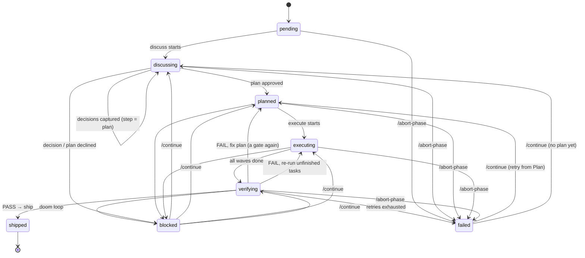

# 26 — The Phase Loop (`agent/multiagent/phases/`)

The spec-driven project mode: a milestone is driven one phase at a time through

```
Discuss → Plan → Execute → Verify → Ship → (next phase)
```

until every phase has shipped. Its state lives on disk and survives `/new`, restarts and
cancelled runs; every task runs in a fresh context; and a phase cannot ship until its
verification criteria are met with evidence — for ML work, numbers. Status: **Built**
(2026-09-29), tested by `tests/test_phase_loop.py` (15 tests, no model endpoint, no Docker).

Every claim below names the implementing file.

**Attribution.** The five-step shape and the artifact vocabulary (STATE / ROADMAP / CONTEXT,
a directory per phase with PLAN / SUMMARY / VERIFY files, "fresh-context subagents", "the file
is the memory") are adapted from [GSD Core](https://github.com/open-gsd/gsd-core), MIT License,
Copyright (c) the GSD Core contributors. It was used as a reference architecture only: no
files from its `agents/` or `commands/` directories and no prompt text are reproduced, and its
installer is not used. The state machine, the ML verification and every prompt here are
Swarn's own (`agent/multiagent/phases/__init__.py` carries the same notice).

---

## 1. Design in one page

| Concern | Decision | Where |
|---|---|---|
| Unit of work | a **milestone** = an ordered roadmap of **phases**; each phase has a goal and a definition of done | `schemas.py: Roadmap, PhaseSpec` |
| State machine | `pending → discussing → planned → executing → verifying → shipped`, plus `failed` and `blocked`; a fixed transition table; a finer `step` (discuss / plan / execute / verify / ship) says where to resume | `state.py: TRANSITIONS, ProjectState.transition` |
| Persistence | `workspace/projects/<project>/` (path-jailed with `agent/paths.safe_path`); markdown for people + JSON sidecars for code; every write is temp-file + `os.replace`; a transition journal | `artifacts.py: ProjectStore` |
| Gates | every question to a person is an `ApprovalBroker.request` (`agent/core/hitl.py`) — terminal prompt at the REPL, parked for a responder under the dashboard, always audited; a gate nobody can answer is recorded as *pending* in STATE.md and answered later with `/approve` | `gates.py: Gate` |
| Fresh context | each task = a new `ToolAgent` (`specialists.build_agent`) in a new `TeamSession`, seeded only with the plan, this phase's decisions, CONTEXT.md slices and its own spec; no history crosses the boundary | `runner.py: TaskRunner`, `loop.py: _seed_for` |
| Tool policy | the verifier runs registry tools through `ToolCaller`, which applies `requires_approval` × risk tier × approval mode with the same callback / broker a `ToolAgent` uses, then `run_tool` (never raises) | `runner.py: ToolCaller` |
| Verification | one `CheckResult` per criterion: tests, data (schema / leakage / drift), model (metric vs threshold **and** baseline), reproducibility (seeded re-run within tolerance), artifact, review by specialists | `verify.py: Verifier` |
| Failure | diagnosis + fix plan → back to Plan (new tasks, a gate again) or Execute (re-run what did not finish); bounded by `SWARN_PHASES_MAX_RETRIES`; the platform's `DoomLoopDetector` replays the failure signatures and **blocks** a phase that keeps failing the same way | `loop.py: _verify, _thrashing` |
| Ship | roadmap ticked, distilled summary + measurements into CONTEXT.md and into long-term memory (`MemoryManager.record_run`, `task_kind="phase"`), the session banner, the phase directory archived, an approval-gated **local** git commit on `phase/<n>-<slug>` when the workspace is a repository — never a push | `loop.py: _ship, _git_commit` |
| Surfaces | REPL: `/milestone`, `/phases`, `/phase [n]`, `/continue`, `/approve [text]`, `/abort-phase [skip]`; dashboard `GET /api/phases`; every task is a `TeamSession`, so `/story`, `report`, `/answer`, Ctrl+C and the session store see it | `agent/cli.py`, `agent/web/dashboard.py` |
| Knobs | `SWARN_PHASES_*` in `agent/config.py` (§8) | `agent/config.py` |

Reused, not reinvented: `ToolAgent` / `TeamSession` / `build_agent` (the runtime), `call_structured`
(structured drafts), `ApprovalBroker` + `classify_answer` + `audit` (gates), `requires_approval` +
`risk_of_tool` (tool policy), `DoomLoopDetector` (thrash guard), `verdict_keywords` (review verdicts),
`validate_dataset` / `check_leakage` / `check_drift` / `compare_to_profile` / `build_profile`
(data evidence), `agent/ml/diagnostics._eval_rows` + `agent/ml/metrics.score_metric` (model
evidence), the sandbox behind `run_python` / `run_shell` (tests and seeded re-runs),
`MemoryManager.record_run` (memory), `TerminalRenderer` + `ui.banner` (display).

---

## 2. Modules

```
agent/multiagent/phases/
    schemas.py     Pydantic shapes: Roadmap / PhaseSpec, Decisions / Decision, Plan / Task /
                   Criterion, Verification / CheckResult, the *Draft models the model fills,
                   FixPlan; slugify(), estimate_tokens()
    state.py       PhaseRecord, ProjectState, TRANSITIONS, InvalidTransition
    artifacts.py   ProjectStore — paths, atomic JSON + markdown, journal, CONTEXT.md
                   (add / prune / slices), phase files, archive, the workspace manifest
    gates.py       Gate, GateAnswer — pre-answers, yolo, the unattended → pending rule
    runner.py      TaskRunner (fresh sessions), ToolCaller (policed tool calls)
    verify.py      Verifier — the six check kinds, snapshot_baseline(), diagnose(),
                   fix_tasks_for(), parse_metric(), model_metric()
    loop.py        PhaseLoop, LoopResult — the driver and the five steps
```

Import layering is top-down in that order; only `runner.py`, `verify.py` and `loop.py` import from
the rest of the platform.

---

## 3. The state machine (`state.py`)



- `ProjectState.transition(n, status, step=, note=, blocker=)` validates the edge against
  `TRANSITIONS`, appends to the record's `history`, sets `step` (explicitly, or from
  `STEP_FOR_STATUS`), keeps `blocker` only for `blocked` / `failed`, stamps `shipped_at`. An
  invalid edge raises `InvalidTransition` and changes nothing.
- Self-loops (`discussing → discussing`, `planned → planned`, `executing → executing`,
  `verifying → verifying`) exist so a step change inside one status is still a journaled,
  validated transition.
- `PhaseRecord` also carries `attempts` (`verify`, `plan`, `commit_skipped`), `pending_gate`,
  `last_run`, `verify_signatures` (for the doom-loop replay), `commit`, `archived_to`.
  `ProjectState` carries `current_phase`, `milestone_status` (`active | done | aborted`),
  `next_action` (what `/continue` will do) and a project-level `pending_gate` (the roadmap).
- `ProjectStore.transition()` wraps the in-memory transition with the journal append and the
  atomic save of `state.json` + `STATE.md` + `ROADMAP.md`, under one lock.

---

## 4. The artifacts (`artifacts.py`)

```
workspace/projects/                 ACTIVE  ← the active project's slug
workspace/projects/<project>/
    STATE.md      state.json        milestone, current phase, status/step, blockers, pending gate,
                                    last run, next action, a table of every phase
    ROADMAP.md    roadmap.json      phases with [x] as they ship, ← current marker
    CONTEXT.md    context.json      entries {kind, text, phase, tags, ts}: decision | summary |
                                    measurement | lesson | note
    journal.jsonl                   every transition and milestone event, appended
    phases/<n>-<slug>/
        DECISIONS.md  decisions.json
        PLAN.md       plan.json     tasks (id, title, spec, assignee, depends_on, wave, files,
                                    acceptance, status, attempts, runs, note), criteria,
                                    revision, approved, budget (chars per task seed)
        SUMMARY.md    summary.json  per-task summaries, files changed (workspace manifest diff),
                                    execution failures
        VERIFY.md     verify.json   one PASS/FAIL/SKIP line per criterion, a measurements table,
                                    diagnosis + fix plan + return-to on FAIL
        baseline.json               dataset schemas / dtypes / profiles, artifact metrics, the
                                    workspace manifest — taken when the plan is approved
        runs/                       one JSON per task run; TeamSession checkpoints
    archive/<n>-<slug>/             the phase directory, moved here on ship
```

- Every path is resolved with `safe_path(rel, root=workspace)` (the project root) and again
  with `root=<project root>` for phase files: `..` anywhere raises `ValueError`.
- `_write_json` / `_write_text` write `<path>.tmp` then `os.replace`; JSON is written before the
  markdown that mirrors it, so a cancel between the two leaves a stale `.md`, never a stale
  `.json`.
- **CONTEXT.md curation** (`add_context`, `prune_context`): entries carry a priority
  (decision 3, summary 2, measurement / lesson / note 1; the newest phase's decisions +10);
  when the rendered file exceeds `SWARN_PHASES_CONTEXT_MAX_CHARS` the lowest-priority, oldest
  entries are dropped first. `context_slices(query, phase, max_chars)` returns this phase's
  decisions always, then entries ranked by word overlap with the query, newest first — the
  only way CONTEXT.md reaches a prompt.
- `workspace_manifest()` (path → size, mtime, excluding the projects directory) is snapshotted
  into `baseline.json` at plan approval; `manifest_diff` after Execute is the "files changed"
  list the reviewers walk.

---

## 5. The five steps (`loop.py`)

`PhaseLoop.step()` advances the current phase by one step and returns a `LoopResult(status,
phase, step, message, session, gate)`; `run()` repeats while `status == "continue"`. Statuses:
`continue | gate | awaiting | cancelled | blocked | failed | done | stopped | nothing | error`.
Every step loads its inputs from the store and writes its outputs back before returning.

### Discuss (`_discuss`)
`pending → discussing`. Decisions are drafted with `call_structured(DISCUSS_SYSTEM →
DecisionsDraft)` when a model is configured, else `_heuristic_decisions` (scope, metric and
threshold, model family, data source, delivery — chosen from the goal's vocabulary). Each
unanswered decision is one `Gate.decide()` call: options + `other`, default = the
recommended option; the answer is read by `hitl.classify_answer` (agreement → recommended,
an option name or 1-based index → that option, anything else → free text). Answers are saved
after each one (`decisions.json`), so a resume asks only what is still open. Output:
`DECISIONS.md`; every decision becomes a CONTEXT.md entry; `step = plan`.

### Plan (`_plan`)
1. **Research** in a fresh session: the `planner` specialist gets the goal, the decisions and
   CONTEXT slices (`RESEARCH_TASK`) and returns notes. Cancelled → `LoopResult("cancelled")`;
   awaiting a person → `"awaiting"` (answer with `/answer`, then `/continue`).
2. **Draft**: `call_structured(PLAN_SYSTEM → PlanDraft)` with the research, the specialist
   catalogue, the criterion kinds and the limits; without a model, `_heuristic_plan` (one task
   per definition-of-done item, assignee from `find_specialists`, artifact criteria for every
   file the text names, a data criterion for a named dataset in ML work).
3. **Finalise** (`_finalise_plan`): assignees must exist in `SPECIALISTS` (else re-chosen),
   dependencies must be task ids, every metric threshold in the goal / definition of done /
   decisions becomes a `model` criterion (`_thresholds`: `roc_auc >= 0.85`, `rmse below 3`,
   percentages), a `review` criterion is added when none exists, and the **budget** is enforced:
   the seed of each task (`_seed_for`) is measured against `SWARN_PHASES_TASK_CONTEXT_CHARS`
   (chars/4 ≈ tokens, the `SWARN_TOOL_RESULT_MAX_CHARS` style of limit); a spec over 60 % of it
   is shortened with a note pointing at PLAN.md. Estimates are written into PLAN.md.
4. **Baseline**: `Verifier.snapshot_baseline` + the workspace manifest → `baseline.json`.
5. **Gate** `plan:<n>:r<revision>`: approve → `planned` (`step = execute`); a direction →
   `_revise_plan` (the note is folded into the decisions' notes and the draft, revision + 1)
   and the gate is asked again, up to three times; `no` → `blocked` ("plan declined";
   `/continue` asks again).

### Execute (`_execute`)
`planned → executing`. `Plan.waves()` orders tasks by wave, moving a task after any
dependency in a later wave. Per wave, tasks not yet `done` run one after another (or
concurrently with `SWARN_PHASES_WAVE_WORKERS > 1`). Each task: dependencies must be `done`
(else the task fails with a note), `TaskRunner.run_task()` builds the assignee with the
caller's build kwargs and runs a **new** `TeamSession` on the seed:

```
━━━ Phase n: title ━━━         goal, definition of done
━━━ Decisions ━━━              Q → A, settled
━━━ Plan ━━━                   objective, every task with [done | THIS TASK | status],
                               the summaries of the tasks this one depends on
━━━ Your task: Tk ━━━          spec, acceptance, files, [PREVIOUS ATTEMPT] note
━━━ Project context ━━━        CONTEXT.md slices, within what is left of the budget
━━━ Rules ━━━                  this task only; finish_task naming every output
```

Outcomes: `complete` → `done`; `cancelled` → the task goes back to `pending` and the loop
returns `"cancelled"` (STATE.md's next action names the task); `awaiting_*` → `"awaiting"`,
the session checkpointed to `runs/<task>-awaiting.json`, and after `/answer` the REPL calls
`PhaseLoop.absorb(session)` to record the outcome; anything else → retried once
(`SWARN_PHASES_TASK_RETRIES`) with the failure folded into the seed, then `failed`. Every run
is recorded in `runs/` and on the task. When every wave is done: `SUMMARY.md` (task summaries,
changed files, failures) and `executing → verifying`.

### Verify (`_verify`) — see §6
`Verifier.run()` → `Verification` → `VERIFY.md`. Cancelled mid-verification → `"cancelled"`,
not counted. PASS → `step = ship`. FAIL: the signature (failing ids + measurements + detail) is
appended to `verify_signatures` and replayed through `DoomLoopDetector` — three identical or an
A-B-A-B alternation **blocks** the phase; otherwise, past `SWARN_PHASES_MAX_RETRIES`
verifications the phase is `failed`; otherwise the fix is applied: `return_to = "execute"`
resets unfinished tasks and re-runs them; `return_to = "plan"` appends the fix tasks
(`fix_tasks_for`) in a new wave, bumps the revision, clears approval and goes back to the plan
gate.

### Ship (`_ship`)
1. If the workspace is a git repository (`workspace/.git`) and nothing was committed yet:
   gate `commit:<n>` — approve → `git checkout -B phase/<n>-<slug>`, `git add -A`, `git
   commit` (with a fallback identity when none is configured); the short SHA is kept on the
   record. Local only; there is no push anywhere in the package.
2. A distilled summary (goal, objective, decisions, what each task produced, measurements,
   how it was verified) → CONTEXT.md as `summary`, plus up to six `measurement` entries.
3. `MemoryManager.record_run(agent="phase_loop", task="Phase n: …", outcome="complete",
   summary=…, facts=measurements, task_kind="phase")` — the same call every specialist makes,
   so phase outcomes enter episodic memory and the consolidator; no second store.
4. `verifying → shipped`, the phase directory moved to `archive/`, ROADMAP.md ticked, the
   next open phase becomes current (or the milestone is `done`), the session banner
   (`ui.banner` at the REPL) with every phase's mark and the next action.

### Blocked, failed, aborted
`/continue` on a `blocked` phase re-enters the recorded step (`_unblock`); on a `failed`
phase it retries from Plan with the verification counters reset (`_retry_failed`).
`abort_phase(reason, skip=)` marks the current phase `failed` (`skip` moves on to the next
pending phase, or aborts the milestone when none is left).

---

## 6. ML-specific verification (`verify.py`)

Each criterion in PLAN.json is `{"id", "kind", "description", "params"}`; each produces a
`CheckResult {id, kind, status PASS|FAIL|SKIP, measured, expected, detail}`. Checks never raise
(an exception is a FAIL quoting it) and run cheapest first (artifact, data, tests, model,
reproducibility, review).

| Kind | Params | Evidence | PASS when |
|---|---|---|---|
| `tests` | `command` (run_shell) or `code` (run_python), `expect` | the sandbox output; `[exit N]`, timeouts and tracebacks are read from it | exit 0, no traceback, `expect` present |
| `data` | `dataset`, `target`, `baseline_profile`, `baseline_dataset`, `require_columns`, `allow_dtype_change` | `validate_dataset`; columns and dtypes vs the `baseline.json` snapshot; `check_leakage(dataset, target)`; `check_drift(dataset, profile)` or `compare_to_profile(df, snapshot profile)` | validates, no missing baseline column, no dtype change, no `[HIGH]` leakage finding, no `HIGH` drift finding |
| `model` | `artifact` ('' = the newest), `metric`, `threshold`, `direction` (`max` / `min`, inferred for rmse/mae), `eval_on`, `baseline`, `min_gain` | `model_metric()`: the artifact's stored hold-out metric, or — with `eval_on` — the metric recomputed on those rows via `agent/ml/diagnostics._eval_rows` and `agent/ml/metrics.score_metric` (probabilities for AUC); baseline from the params, `baseline.json`'s artifact metrics, or its metric map | the threshold is met **and** (when `min_gain` is set) the gain over the baseline is at least that; the gain is always recorded |
| `reproducibility` | `entrypoint` (workspace script) or `tool` + `input`, `metric`, `tolerance` (`SWARN_PHASES_VERIFY_TOLERANCE`), `seed` (`SWARN_PHASES_SEED`), `runs` (`SWARN_PHASES_REPRO_RUNS`), `reference` | the script is re-run in the sandbox under `runpy` with `PYTHONHASHSEED`, `SWARN_SEED`, `random.seed` and `numpy.random.seed` set; `parse_metric` reads `metric=value`, `metric: value` or a JSON line; the reference is the params', the model check's measurement in this verification, or the baseline's; with no reference two seeded runs must agree | every run within the relative tolerance of the reference |
| `artifact` | `path`, `min_bytes`, `must_contain` | the file (or directory) under the workspace jail | exists, big enough, says what it must |
| `review` | `reviewers` (default `["reviewer"]`), `focus` | each reviewer runs in a fresh session on `REVIEW_TASK` (goal, definition of done, SUMMARY.md, changed files, criteria) and must answer `APPROVED` / `NEEDS_CHANGES`, read by `verdict_keywords()` | every reviewer approved |

Execution failures (tasks that never reached `done`) are added as `kind = "execution"` FAIL
lines so the diagnosis covers them. `diagnose()` asks the model (`FIX_SYSTEM → FixPlan`) when
one is configured, otherwise writes a deterministic diagnosis; `return_to` is `execute` only
when every failure is an execution failure and no new task was proposed. `fix_tasks_for()`
turns each failed criterion into a task for the specialist that owns that kind of evidence
(`model → classical_ml_builder`, `data → data_science_analyst`, `reproducibility →
debug_optimizer`, otherwise `coder`), never lowering a threshold.

`VERIFY.md`:

```
# VERIFY — Phase 2: Model (attempt 1) — **FAIL**

PASS V1 [data] schema, leakage and drift checks clean
FAIL V2 [model] roc_auc=0.8123 does not meet ≥ 0.85
PASS V3 [reproducibility] roc_auc reproduced: 0.8123 vs 0.8123
PASS V4 [review] reviewer approved

## Measurements
| criterion | measured | expected |
| V2 | roc_auc=0.8123, artifact=churn__xgboost, scored_on=churn_test_features, baseline=0.79, gain=0.0223 | roc_auc ≥ 0.85 |
...
## Diagnosis / ## Fix plan / Return to: **plan**
```

---

## 7. Gates and the approval policy (`gates.py`, `runner.py`)

- `Gate.ask(name, question, default, options, auto)` → `GateAnswer(kind approve | stop |
  redirect | pending, via broker | command | yolo | none)`. Order: a **pre-answer** for that
  gate name (`/approve [text]` re-enters the loop with `gate.pre_answers[name] = text`,
  audited `via: command`); **yolo** (approval gates read `yes`, decisions their recommended
  option, audited `via: yolo`); **unattended** (`ApprovalBroker.can_answer` is false: no
  responder, no terminal) → `pending`, audited with `"pending": true`, recorded in STATE.md;
  otherwise `ApprovalBroker.request("phase:<name>", …)`, which audits itself.
  `ApprovalBroker.can_answer` is the one addition to `agent/core/hitl.py`.
- Gate names: `roadmap`, `discuss:<n>:<Dk>`, `plan:<n>:r<rev>`, `commit:<n>`.
- Specialists under the loop are built with the REPL's own build kwargs
  (`approval_mode = always_require` + `_GuardedApprover`, `_terminal_question`, the sitting's
  session, the iteration cap; `/yolo` → `never`), so tool approvals look and behave exactly as
  for a task typed at the prompt.
- `ToolCaller(approval_mode, approval_callback, broker)` gives the verifier the same gate for
  direct tool calls: read-only tools run; a gated tool asks the callback or broker, and with
  neither it is **declined** ("no one could approve it"). Docker / subprocess policy is
  unchanged — the calls go through `run_tool`.

---

## 8. Configuration (`agent/config.py`)

| Variable | Default | Effect |
|---|---|---|
| `SWARN_PHASES_DIR` | `projects` | workspace subdirectory holding every project |
| `SWARN_PHASES_MAX_RETRIES` | `2` | verify → fix → re-execute cycles before a phase is `failed` |
| `SWARN_PHASES_TASK_RETRIES` | `1` | re-runs of a task that failed or was cancelled before it counts as failed |
| `SWARN_PHASES_VERIFY_TOLERANCE` | `0.02` | relative tolerance of the reproducibility check |
| `SWARN_PHASES_TASK_CONTEXT_CHARS` | `24000` | seed budget per fresh task session (≈ tokens × 4) |
| `SWARN_PHASES_CONTEXT_MAX_CHARS` | `20000` | CONTEXT.md size before pruning |
| `SWARN_PHASES_MAX_TASKS` | `12` | tasks per phase plan |
| `SWARN_PHASES_MAX_PHASES` | `12` | phases per roadmap |
| `SWARN_PHASES_WAVE_WORKERS` | `1` | tasks of one wave run concurrently |
| `SWARN_PHASES_SEED` | `42` | the seed of the reproducibility re-run |
| `SWARN_PHASES_REPRO_RUNS` | `1` | seeded re-runs per reproducibility check |

---

## 9. Surfaces

**REPL** (`agent/cli.py`: `_phase_loop_for`, `_phase_command`, `_phase_show`, `run_phase`):

| Command | Does |
|---|---|
| `/milestone [project:] <goal>` | creates the project (slug from the first words, or the prefix), drafts the roadmap, asks the roadmap gate, then runs until a gate / block / ship / done |
| `/phases` | ROADMAP.md |
| `/phase [n]` | the current (or nth) phase: status, decisions, plan tasks, verification lines, the waiting gate, the directory |
| `/continue` | `PhaseLoop.run()` from the recorded state — after `/new`, a restart or a cancel |
| `/approve [yes\|no\|text]` | pre-answers the waiting gate and continues |
| `/abort-phase [skip] [reason]` | marks the phase failed; `skip` moves to the next |

Every task session is adopted as the REPL's current `session`, so `/story`, `report`, `/answer`
and the Ctrl+C steering menu (pause, inject, cancel) work on it unchanged; a cancel leaves the
phase resumable. Each phase command is a `USER_TURN` of the sitting's session, and every
specialist the loop builds logs into that session (`session=` in the build kwargs), so
`/history`, `/recall` and the dashboard's session views show the phase's runs. The trajectory
of every task session is persisted (`runs/trajectories/`).

**Dashboard**: `GET /api/phases[?project=]` — projects, the active one's state, roadmap, per-phase
tasks / criteria / verification, and the tail of CONTEXT.md. Read-only.

---

## 10. Tests (`tests/test_phase_loop.py`)

Fifteen tests, scripted agents (`tests/fakes_multiagent.FakeAgent`), a temporary workspace, no
model: the transition table; atomic markdown + JSON inside the jail and CONTEXT pruning /
slicing; Discuss through a responder-backed broker; the unattended gate → pending → pre-answer;
plan approval, thresholds → model criteria, the seed budget and the revise-on-direction path;
one fresh session per task with a seed that carries the plan and decisions but never another
task's transcript; the verifier against real fixtures (a pandas dataset with duplicated rows
for leakage, a dtype change against the baseline, a fitted scikit-learn artifact recomputed
on a named dataset, a seeded re-run through the subprocess sandbox, tests that exit non-zero);
fix plans, bounded retries and the doom-loop block; cancel mid-phase and resume on a fresh
loop instance; a task that exits for a person, answered and absorbed; ship with memory, the
banner, the archive and a real local git commit; abort / skip; the policed tool caller; the
REPL command layer; the dashboard endpoint.
